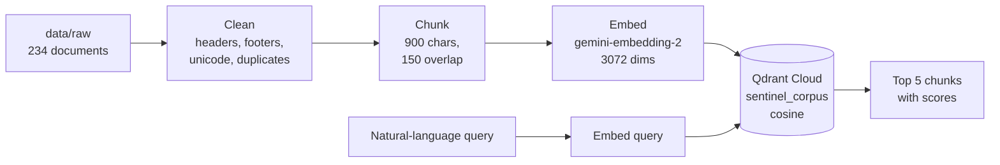

# SENTINEL Vector Search: RAG and Vector Database

Turns the SENTINEL payment-fraud document corpus into vectors and makes it searchable by meaning, using **Gemini Embedding 2 (3072 dimensions)** and **Qdrant Cloud**.

Euron Super 30 · Class: RAG and Vector Database



## What it does

| Step | Assignment requirement | Where |
|---|---|---|
| 1 | Free Qdrant Cloud cluster, `get_collections` health check | `scripts/health_check.py` |
| 2 | 200+ SENTINEL documents, cleaned and chunked, chunk size and overlap explained | `scripts/generate_corpus.py`, `src/sentinel_rag/cleaning.py`, `chunking.py` |
| 3 | Embed every chunk with Gemini Embedding 2 (3072 dims) via Google API or Euron EURI | `src/sentinel_rag/embeddings.py` |
| 4 | Collection with the right size and distance, points with payload (source document, document type, chunk number) | `src/sentinel_rag/store.py`, `scripts/ingest.py` |
| 5 | 10 natural-language searches, top 5 with scores, plus one search with a payload filter | `scripts/search.py` |

## The corpus

**234 unique documents** in four types (240 raw files, 6 of them exact duplicates that the cleaner drops):

| `doc_type` | Count | What it is |
|---|---|---|
| `guideline` | 28 | RBI and NPCI guidance in plain language: customer liability for unauthorised transactions, UPI disputes and chargebacks, device binding, mule accounts, failed-transaction turnaround times, and more |
| `playbook` | 22 | One investigation playbook per fraud type (account takeover, SIM swap, QR scam, mule account, digital arrest, card testing and others), each with signals, checks, containment and evidence |
| `investigator_note` | 92 | Case notes with case ID, amount, channel, device, observations, checks performed and outcome |
| `chargeback` | 92 | Dispute narratives with reason, merchant, customer claim, merchant response, investigation and decision |

> **The corpus is synthetic.** `scripts/generate_corpus.py` writes it for coursework. The guideline files describe the kind of rules found in RBI and NPCI circulars, in my own words. They are **not** official text. Check the current circular before you rely on any number.

The raw files include the clutter real exports have, so the cleaning step has real work to do: a repeated confidential header, `Page n of m` footers, form feeds, smart quotes, double spaces, Windows line endings and duplicate files.

**Using your pod's real corpus:** put files in `data/raw/<doc_type>/*.txt` (or `.md`). The folder name becomes the `doc_type` payload field. Then run `python scripts/ingest.py --recreate`.

## Cleaning

`cleaning.py` does the following to each file:

1. Normalises unicode (NFKC) and changes smart quotes and dashes to plain ASCII.
2. Changes `\r\n` and form feeds to `\n`.
3. Drops boilerplate lines: the confidential header, page footers and the repeated disclaimer.
4. Collapses runs of spaces and keeps at most one blank line between paragraphs.
5. Drops near-empty files and removes **exact duplicates** by SHA-256 of the cleaned text.
6. Takes the title from the heading line, removes it from the body and stores it in the payload.

## Chunking: 900 characters, 150 overlap

**Chunk size: 900 characters (about 200 to 225 tokens). Overlap: 150 characters (about 17%, one or two sentences).**

The chunker is sentence-aware (`chunking.py`). It packs whole sentences up to 900 characters. Then it starts the next chunk with the last sentences of the previous one, up to 150 characters. Section headings such as `4. Customer negligence` or `Outcome:` stay attached to the sentence after them, and list numbers like `3.` never get split from their text.

Why these numbers:

- **They fit the documents.** Median cleaned lengths are 506 characters for chargebacks, 793 for investigator notes, 842 for guidelines and 1,033 for playbooks. At 900, almost every chargeback and case note stays as **one chunk**, so a case's observations, checks and outcome are found together. Guidelines and playbooks split into about 2 to 4 chunks along their section boundaries.
- **One idea per vector.** A guideline section such as "limited liability" is about 400 to 600 characters. A 900-character chunk holds one or two sections, so its vector stays focused. That gives sharper similarity scores than a chunk that mixes five rules.
- **The overlap protects rules that have conditions.** Many rules are "X applies *if* Y within Z days". A 150-character overlap means a sentence cut at a boundary also appears whole in the next chunk.
- **Well inside the model limit.** Gemini Embedding 2 accepts 8,192 input tokens, so size is chosen for retrieval quality, not to fit the model.

Alternatives I measured on this corpus:

| Size / overlap | Chunks | Median chunk | Problem |
|---|---|---|---|
| 500 / 80 | 472 | 441 chars | Splits case notes in the middle, so observations are separated from the outcome |
| **900 / 150** | **270** | **661 chars** | **Chosen** |
| 1500 / 250 | 238 | 719 chars | Merges unrelated guideline sections (for example liability caps with reporting channels), which dilutes the vector |

Both values can be changed in `.env` (`CHUNK_SIZE`, `CHUNK_OVERLAP`).

## Embedding: Gemini Embedding 2

- Model `gemini-embedding-2`, **3072 dimensions** (the default and maximum; vectors come back already normalised).
- **Task prefixes go in the text.** Gemini Embedding 2 does not accept the `task_type` field. Following Google's format for asymmetric retrieval:
  - each chunk is embedded as `title: {document title} | text: {chunk}`
  - each query is embedded as `task: search result | query: {question}`

  Putting the document title in front of every chunk also gives each chunk its document's context.
- **One vector per chunk.** If you pass Gemini Embedding 2 a plain list of strings, it returns **one combined vector** for the whole list. I checked the request the SDK builds: a list of strings becomes one request with several parts, while a list of `types.Content` objects becomes one request per item. The code sends one `Content` per chunk and checks that the number of vectors equals the number of chunks and that each vector has 3072 dimensions.
- **Two providers**, chosen with `EMBED_PROVIDER`:
  - `google`: Gemini API through the `google-genai` SDK.
  - `euri`: Euron EURI gateway through its OpenAI-compatible `/embeddings` endpoint. If the gateway ever returns fewer vectors than inputs, the code falls back to one call per chunk.
- Retries with exponential backoff on 429 and 503 errors. Batch size and the pause between batches can be set for free-tier limits.
- A **local cache** (`data/cache/`, git-ignored) stores every vector, so running ingest again costs nothing and resumes after an interruption.

## Qdrant collection

| Setting | Value | Why |
|---|---|---|
| Name | `sentinel_corpus` | |
| Vector size | 3072 | Must match the embedding dimension exactly |
| Distance | Cosine | Gemini embeddings are compared by direction, and Google recommends cosine similarity for them |
| Point ID | UUIDv5 of `source_document#chunk_number` | The same chunk always gets the same ID, so re-running ingest overwrites instead of creating duplicates |
| Payload indexes | `doc_type` (keyword), `source_document` (keyword), `chunk_number` (integer) | Fast filtered search; Qdrant Cloud strict mode needs an index on any field you filter on |

Payload of each point:

```json
{
  "source_document": "guideline/rbi-customer-liability.txt",
  "doc_type": "guideline",
  "chunk_number": 2,
  "total_chunks": 3,
  "title": "RBI — Customer Liability In Unauthorised Electronic Banking Transactions",
  "text": "3. Limited liability: When the customer reports a third-party breach between four and seven working days ..."
}
```

## Setup

### 1. Create a free Qdrant Cloud cluster

1. Sign in at [cloud.qdrant.io](https://cloud.qdrant.io) and create a **Free** cluster (1 GB is plenty: 270 vectors × 3072 floats is about 3.3 MB).
2. Copy the cluster **Endpoint** URL (it ends in `:6333`).
3. Under **API Keys**, create a key for the cluster.

### 2. Get an embedding key

- **Google:** create a key at [aistudio.google.com/apikey](https://aistudio.google.com/apikey) and set `EMBED_PROVIDER=google`.
- **Euron EURI:** copy your key from the EURI dashboard, set `EMBED_PROVIDER=euri`, and set `EMBED_MODEL` to the Gemini Embedding 2 model name the dashboard lists.

### 3. Install

```bash
git clone https://github.com/<your-username>/sentinel-vector-search.git
cd sentinel-vector-search
python -m venv .venv
source .venv/bin/activate          # Windows: .venv\Scripts\activate
pip install -r requirements.txt
cp .env.example .env               # then edit .env with your keys
```

## How to run

```bash
# 1. Health check: connects to Qdrant and calls get_collections (and one test embedding)
python scripts/health_check.py --embedding

# 2. (Optional) regenerate the corpus. It is already committed in data/raw
python scripts/generate_corpus.py

# 3. Clean, chunk, embed and upsert
python scripts/ingest.py --recreate

# 4. Run the 10 searches plus the filtered search
python scripts/search.py

# Ad-hoc search, with or without a filter
python scripts/search.py -q "customer installed a screen sharing app" --doc-type playbook
```

`search.py` prints a table for each query and saves `results/search_results.md` and `results/search_results.json`.

### Tests (offline, no keys needed)

```bash
pytest -q
```

The tests use an in-memory Qdrant and a fake hashed embedder. They check cleaning, deduplication, chunk sizes and overlap, idempotent upserts, top-5 search and the payload filter. To dry-run the scripts with no keys, set `QDRANT_URL=local:./qdrant_local` and `EMBED_PROVIDER=fake`. The scores from the fake embedder are keyword-based and **not** meaningful; use real Gemini output for the submission.

## The searches

| # | Query | Expected best source |
|---|---|---|
| 1 | What should an investigator check when a new device makes a large payment? | Account-takeover playbook, device security guideline |
| 2 | A customer reported an unauthorised debit five days after the alert. How much of the loss do they bear? | Customer liability guideline (limited liability, 4 to 7 days) |
| 3 | How do we spot an account that receives money from many victims and moves it out quickly? | Mule account playbook and guideline |
| 4 | The victim was selling a sofa online and the buyer sent a QR code saying scan it to receive the money | QR scam playbook |
| 5 | How many days does the bank have to credit the disputed amount back to the customer? | Customer liability guideline (shadow reversal) |
| 6 | The customer's phone suddenly lost signal in the evening and then money was transferred out | SIM swap playbook and notes |
| 7 | Merchant ticket sizes do not match its business category and customers don't recognise the merchant name | Transaction laundering playbook, payment aggregator guideline |
| 8 | Elderly customer kept on a video call by people claiming to be police broke an FD and transferred money | Digital arrest playbook |
| 9 | My UPI payment failed but the money was debited from my account. When will I get it back? | Failed-transaction turnaround guideline |
| 10 | What evidence does a merchant need to win a goods-not-received dispute? | UPI chargeback guideline, chargeback narratives |
| 11 | **Filtered:** Customer shared an OTP with a caller pretending to be from the bank, with `doc_type = investigator_note` | Only investigator notes come back |

Most of these queries share few words with the text they should match. For example, query 6 says "lost signal", not "SIM swap", and query 8 never says "digital arrest". That is the point: the matches have to come from meaning, not keywords.

## Screenshots

<!-- Replace these after your run. Save images in docs/screenshots/. -->

| | |
|---|---|
| Health check |  |
| Ingest |  |
| Search (top 5 with scores) |  |
| Filtered search |  |
| Qdrant Cloud dashboard |  |

Full output of every query: [`results/search_results.md`](results/search_results.md)

## Project structure

```
sentinel-vector-search/
├── data/
│   ├── raw/                  # 240 raw files in 4 doc_type folders (committed)
│   └── processed/            # documents.jsonl and chunks.jsonl, written by ingest
├── docs/screenshots/
├── results/                  # ingest_summary.json, search_results.md/.json
├── scripts/
│   ├── cosine_search.py      # task: hand-compute, brute-force, benchmark, HNSW
│   ├── generate_corpus.py    # writes the synthetic SENTINEL corpus
│   ├── health_check.py       # step 1
│   ├── ingest.py             # steps 2-4
│   └── search.py             # step 5
├── src/sentinel_rag/
│   ├── config.py             # settings from .env
│   ├── cleaning.py           # load, clean, dedupe
│   ├── chunking.py           # sentence-aware chunker
│   ├── embeddings.py         # Google / EURI / fake embedders + cache
│   └── store.py              # Qdrant collection, upsert, search
├── tests/test_pipeline.py
├── .env.example
├── requirements.txt
└── README.md
```

## Publish to GitHub

```bash
git init -b main
git add -A
git status            # .env must NOT be listed
git commit -m "SENTINEL semantic search with Gemini Embedding 2 and Qdrant Cloud"
gh repo create sentinel-vector-search --public --source=. --push
```

## Understanding Vector Search

`scripts/cosine_search.py` demonstrates every concept behind vector databases, from scratch:

1. **Hand-computed example** — the class 2D points `(2,3)`, `(1,2)`, `(0,4)` with query `(2,4)`: Euclidean distance and cosine similarity are calculated by hand and ranked.
2. **Brute-force top-k** — NumPy computes both metrics over 1,000 Gemini Embedding 2 vectors (3072 dimensions each).
3. **Qdrant verification** — the same queries run in an in-memory Qdrant collection; top-k indices and scores match the NumPy results.
4. **Normalised vectors** — after L2-normalisation, cosine similarity and dot product give identical rankings, because normalised vectors have unit length and `cos(a,b) = a·b`.
5. **Benchmark** — brute force vs Qdrant (with an HNSW index) for 1K and 10K vectors. Qdrant is faster by orders of magnitude at 10K.

### What HNSW changes

Brute-force search checks every vector: **O(n)** comparisons. At 10K vectors this takes ~0.4 s on a laptop; at 100M it would take minutes.

HNSW (Hierarchical Navigable Small World) builds a multi-layer graph index. A query enters at the top layer (coarse, few nodes) and navigates down through increasingly fine layers, landing in the right neighbourhood in **O(log n)** steps. At 10K vectors this takes ~0.2 ms — a **2000× speed-up** for the same query. The trade-off is index build time and extra memory, but the result is that real-world vector databases handle millions of vectors in milliseconds.

## Security

- Keys live only in `.env`, which `.gitignore` excludes. `.env.example` holds placeholders only.
- Before pushing, check with `git status` that `.env` is not listed.

## Troubleshooting

| Problem | Fix |
|---|---|
| `429` / `RESOURCE_EXHAUSTED` | The code retries automatically. On a free tier, set `EMBED_BATCH_SIZE=8` and `EMBED_PAUSE_SECONDS=5`. Thanks to the cache, a re-run continues where it stopped. |
| `collection has size 768, expected 3072` | The collection was made with another dimension. Run `python scripts/ingest.py --recreate`. |
| `Bad request: Index required` on filtered search | Your collection was created without the payload index. Run ingest with `--recreate`. |
| Qdrant timeout | Check that the URL includes `https://` and `:6333`, and that the API key belongs to that cluster. |
